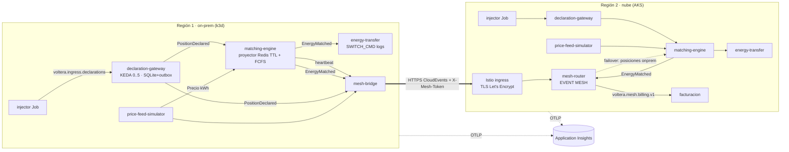

# Voltera · Lab EDA + Event Mesh (P2P de energía)

Laboratorio / PoC que valida la **Arquitectura Dirigida por Eventos** y la capa de **Event Mesh multirregión**
de Voltera según [`docs/ARCH.md`](docs/ARCH.md). Cada componente es un **mock liviano en Go** sobre
**Redpanda** (Kafka API), con trazas **OpenTelemetry → Application Insights**.

| Región | Cluster | Rol |
|---|---|---|
| **1 · on-prem** | k3d `voltera-onprem` (contexto `k3d-voltera-onprem`) | Pipeline regional + `mesh-bridge` |
| **2 · nube** | AKS `voltera-dev-aks` (contexto `voltera-dev-aks`) | Pipeline regional + **Event Mesh** (`mesh-router`) + **Facturación** |

## Arquitectura



* **Pub/Sub desacoplado**: cada región tiene su Redpanda; los servicios solo conocen topics.
* **Event Mesh**: el `mesh-router` autentica la región on-prem (token), consolida `EnergyMatched` de ambas
  regiones con **deduplicación por `ce-id`** y los entrega a Facturación.
* **Failover**: si el heartbeat del `matching-engine` on-prem falta > 15 s, el mesh reenvía las posiciones
  y precios on-prem (incluido un replay del buffer reciente) al `matching-engine` de la nube.
* Detalle de routing, estados y garantías: [`docs/EVENT_MESH.md`](docs/EVENT_MESH.md).

### Catálogo de eventos (CloudEvents 1.0, modo binario)

| Topic | `ce-type` | Productor → Consumidor |
|---|---|---|
| `voltera.ingress.declarations` | `com.voltera.ami.declaration.v1` | injector → declaration-gateway |
| `voltera.position.declared.v1` | `com.voltera.position.declared.v1` | declaration-gateway → matching-engine, mesh-bridge |
| `voltera.price.kwh.v1` | `com.voltera.price.kwh.v1` | price-feed-simulator → matching-engine, mesh-bridge |
| `voltera.energy.matched.v1` | `com.voltera.energy.matched.v1` | matching-engine → energy-transfer, mesh-bridge / mesh-router |
| `voltera.mesh.heartbeat.v1` | `com.voltera.mesh.heartbeat.v1` | matching-engine → mesh-bridge → mesh-router |
| `voltera.mesh.failover.positions.v1` | (posición / precio original) | mesh-router → matching-engine (nube) |
| `voltera.mesh.billing.v1` | `com.voltera.energy.matched.v1` | mesh-router → facturacion |

Headers Kafka: `ce_id`, `ce_type`, `ce_source`, `ce_time`, `ce_region` (región de origen) y `traceparent` (W3C).

## Estructura

```
services/            Módulo Go único (imagen voltera-eda con todos los binarios en /svc/<nombre>)
  cmd/               declaration-gateway, price-feed-simulator, matching-engine, energy-transfer,
                     mesh-bridge, mesh-router, facturacion, injector
  internal/platform  Kafka (franz-go), CloudEvents, OTel, HTTP
  internal/domain    topics, tipos y payloads
deploy/              Kustomize: base (Redpanda, Redis, OTel collector, pipeline, KEDA),
                     onprem (+ mesh-bridge), cloud (+ mesh-router, facturacion, Istio edge),
                     cloud-edge (cert-manager/Let's Encrypt), jobs/injector.yaml
scripts/lab.ps1|sh   CLI del lab (build, deploy, inject, failover-test, trace, cleanup...)
infra/               k3d local, add-ons (KEDA / Istio edge + cert-manager), Terraform AKS + ACR + App Insights
docs/                ARCH.md (objetivo), EVENT_MESH.md, LAB_RUNBOOK.md, FINOPS_AKS.md, modelos
```

> El experimento de idempotencia (`src/services/match-processor`, `k8s/`, `scripts/idempotency`,
> `tests/04_*`, `docs/IDEMPOTENCY_*`) es trabajo independiente que se conserva tal cual; no forma parte
> del despliegue EDA.

## Quickstart

Requisitos: Docker, k3d, kubectl, helm, az CLI (logueado), terraform, PowerShell 7 (o bash).

```powershell
.\infra\manage.ps1 local start                 # k3d voltera-onprem (si no existe)
.\infra\manage.ps1 azure start                 # encender AKS (FinOps)
.\infra\manage.ps1 azure apply                 # Terraform: ACR + AcrPull (quita APIM / Event Grid)
.\scripts\lab.ps1 addons -Target all           # KEDA local | Istio edge + cert-manager + KEDA en AKS
.\scripts\lab.ps1 up -Target all               # build + push/import + secrets + deploy en ambas regiones
.\scripts\lab.ps1 inject -Target onprem -N 200 # inyección sintética (imprime trace ids)
```

Equivalente bash: `./scripts/lab.sh up all`, `N=200 ./scripts/lab.sh inject onprem`.

## Medición (ARCH §4)

1. **Traza de interoperabilidad**: `.\scripts\lab.ps1 trace` (usa el último trace id del injector) →
   en App Insights la *end-to-end transaction* muestra `injector → declaration-gateway → matching-engine →
   mesh-bridge (k3d) → mesh-router (AKS) → facturacion` con `cloud_RoleName = voltera.<servicio>`.
2. **Failover**: `.\scripts\lab.ps1 failover-test` apaga el `matching-engine` local, inyecta, verifica
   `NORMAL → FAILOVER_ACTIVE`, que Facturación registre calces `onprem->cloud`, y restaura (`→ NORMAL`).
3. **KEDA 0..N**: durante `inject`, `kubectl -n voltera get pods -w` muestra `declaration-gateway`
   escalando desde 0 y volviendo a 0 tras el cooldown.

Paso a paso con evidencia esperada: [`docs/LAB_RUNBOOK.md`](docs/LAB_RUNBOOK.md).

## FinOps

* AKS: 1× `Standard_B4ms`, SKU Free; apagado automático 20:00 COT (Azure Automation) y manual con
  `.\scripts\lab.ps1 aks -Action stop`. Apagado ⇒ solo se paga disco/IP.
* ACR Basic (~5 USD/mes). APIM y Event Grid eliminados (no están en ARCH).
* Redpanda con `emptyDir` y retención 1 h (sin discos administrados). Log Analytics con cap 0.5 GB/día;
  heartbeats y health checks no generan trazas.
* Detalle: [`docs/FINOPS_AKS.md`](docs/FINOPS_AKS.md).
