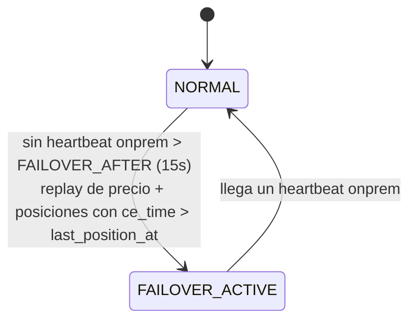

# Event Mesh del lab EDA

El Event Mesh es la capa que interconecta las dos regiones (on-prem en k3d y nube en AKS). Está
implementado por dos componentes en `services/cmd/`:

| Componente | Región | Responsabilidad |
|---|---|---|
| `mesh-bridge` | on-prem | Conector de ingesta: consume del Redpanda local y reenvía al mesh por HTTPS. |
| `mesh-router` | nube | Router central: autenticación, observabilidad, deduplicación, enrutamiento a Facturación y failover. |

## 1. Conectividad y autenticación

```
k3d (detrás de NAT) --HTTPS--> voltera-dev-mesh.eastus2.cloudapp.azure.com (Istio ingress, LB público)
                               /mesh/events --> mesh-router.voltera:80
```

* Solo hay tráfico **saliente** desde on-prem: el bridge empuja, la nube nunca llama a k3d.
* **TLS**: certificado Let's Encrypt (`deploy/cloud-edge`, cert-manager HTTP-01) en el Istio ingress.
* **Autenticación de región**: header `X-Mesh-Token` (Secret `mesh-token`, mismo valor en ambos
  clusters, generado por `lab.ps1 secrets`). Comparación en tiempo constante; 401 si no coincide.
* Solo `/mesh/*` se publica. `/status` del router es interno (se consulta vía proxy del API server).
* Istio actúa **solo como edge** (sin sidecars en `voltera`), lo que ahorra recursos y evita conflictos con
  KEDA scale-to-zero y Jobs.

## 2. Formato

CloudEvents 1.0 en **modo binario**:

| Transporte | Atributos | Traza |
|---|---|---|
| Kafka | `ce_id`, `ce_type`, `ce_source`, `ce_time`, `ce_region` | header `traceparent` |
| HTTP | `Ce-Id`, `Ce-Type`, `Ce-Source`, `Ce-Time`, `Ce-Region` | header `traceparent` |

`ce_region` indica la **región de origen del hecho de negocio**. Se conserva aunque otro cluster procese
el evento. El payload `EnergyMatched` lleva además `origin_region` y `processed_by`.

## 3. Enrutamiento

| Entrada | Origen | Acción |
|---|---|---|
| `EnergyMatched` vía HTTP | on-prem (bridge) | dedup → `voltera.mesh.billing.v1` |
| `EnergyMatched` vía Kafka (`voltera.energy.matched.v1` de AKS) | nube, incluidos los calces hechos en failover | dedup → `voltera.mesh.billing.v1` |
| `heartbeat` | on-prem | actualiza la salud de la región; si estaba en failover, vuelve a `NORMAL` |
| `PositionDeclared` / `Precio kWh` | on-prem | se guardan en un buffer de 60 s (`REPLAY_WINDOW`); en `FAILOVER_ACTIVE` se reenvían a `voltera.mesh.failover.positions.v1` |

* **Deduplicación**: `SETNX mesh:seen:<ce-id>` en Redis con TTL de 24 h. Si la publicación falla, se
  libera la clave y se responde 503, y el bridge reintenta (at-least-once).
* **Facturación** valida el esquema (`total == kwh * precio`), deduplica por `match_id` y expone `/stats`
  (incluye `by_route`: `onprem->onprem`, `onprem->cloud`, `cloud->cloud`) y `/invoices`.

## 4. Máquina de estados del failover



1. El `matching-engine` publica un heartbeat cada 5 s con `last_position_at`, que es el `ce_time` de la
   última posición procesada. Los heartbeats no generan spans.
2. El watchdog del router evalúa la salud cada segundo. Si nunca vio la región, cuenta desde su propio
   arranque (periodo de gracia).
3. Al entrar en `FAILOVER_ACTIVE`, el router hace replay del último precio on-prem y de las posiciones
   on-prem posteriores a `last_position_at`. A partir de ahí reenvía en vivo cada posición y precio
   on-prem al `matching-engine` de la nube.
4. El engine de la nube mantiene un **libro separado por región de origen** (`book:onprem:*`), así que no
   mezcla prosumidores de regiones distintas. Los calces quedan marcados con `origin_region=onprem` y
   `processed_by=cloud`.
5. Cuando el engine local vuelve, publica un heartbeat **antes** de consumir su backlog. Si estuvo caído
   más que `FAILOVER_AFTER` (lo detecta con `engine:last_alive` en su Redis), descarta las posiciones
   anteriores a su arranque, porque ya las procesó la nube.

**Garantías y límites (lab):**
* At-least-once de punta a punta. Los duplicados de transporte se eliminan en el mesh (`ce-id`) y en
  Facturación (`match_id`).
* Hay una ventana de ~1–2 s alrededor de la recuperación en la que una posición puede calzarse en ambas
  regiones (carrera entre el heartbeat y la posición en el bridge). Queda visible en `by_route`.
* Si la nube está caída, el bridge no confirma offsets y el lag se acumula en Redpanda local.
  `rpk group describe mesh-bridge` lo muestra.

## 5. Observabilidad

* Cada servicio exporta spans OTLP al `otel-collector` de su cluster, que los envía a Application
  Insights (`voltera-dev-appinsights`).
* Una traza por declaración: `inject declaration` → `publish/process voltera.ingress.declarations` →
  `publish voltera.position.declared.v1` (vía outbox) → `match FCFS` (con *span link* a la posición
  contraparte) → `POST mesh-router` (dependency, k3d) → `mesh ingest` (request, AKS) →
  `publish voltera.mesh.billing.v1` → `process` en facturacion.
* `cloud_RoleName` = `voltera.<servicio>` (service.namespace.service.name); `cloud.region` = `onprem` | `cloud`.
* El orden por `timestamp` puede verse levemente alterado por el desfase de reloj entre WSL (k3d) y AKS; la jerarquía padre/hijo de la traza es la fuente de verdad.
* Logs JSON con `trace_id` para correlacionar (`kubectl logs`).

## 6. Pruebas manuales

```powershell
# Estado del mesh (interno, vía API server)
kubectl --context voltera-dev-aks get --raw /api/v1/namespaces/voltera/services/mesh-router:80/proxy/status
# Facturación
kubectl --context voltera-dev-aks get --raw /api/v1/namespaces/voltera/services/facturacion:80/proxy/stats
# Autenticación: sin token -> 401
curl -i -X POST https://voltera-dev-mesh.eastus2.cloudapp.azure.com/mesh/events -H "Ce-Id: x" -H "Ce-Type: t"
```
