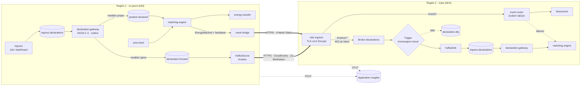
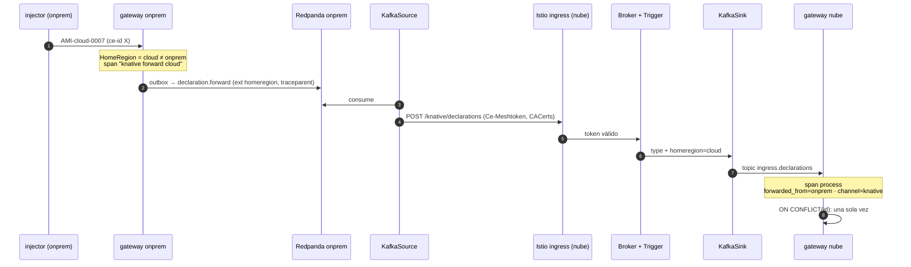

# Runbook del lab EDA (Event Mesh + Knative)

Guía única para entender cómo quedó el lab, probarlo y validarlo. Cubre el pipeline de [`ARCH.md`](ARCH.md),
el Event Mesh propio (`mesh-bridge` → `mesh-router`) y el canal Knative que enruta declaraciones entre
regiones (diseño en [`PLAN_SIMPLIFICACION.md`](PLAN_SIMPLIFICACION.md)).

Los comandos están en PowerShell; el equivalente bash es `./scripts/lab.sh <cmd> <target>`.

> **Estado de verificación.** `knative-test` (prueba C1) y el rechazo sin token (C5) se ejecutaron en los
> clusters reales. El resto de pruebas Knative está marcado **por verificar** en la matriz de §9.

## 1. Cómo quedó: componentes

Dos canales entre regiones, con topics, grupos y rutas separados: el **Event Mesh** transporta lo que ya
está calzado (`EnergyMatched`, precios, heartbeat, failover) y **Knative** transporta declaraciones de
medidores que pertenecen a la otra región.



| | Event Mesh | Knative |
|---|---|---|
| Qué transporta | `EnergyMatched`, precios, heartbeat, replay de failover | Declaraciones de medidores de la **otra** región |
| Componentes | `mesh-bridge` (onprem), `mesh-router` (nube) — código propio en Go | `KafkaSource` (onprem); `Broker`, `Trigger`, 2 `KafkaSink` (nube) — YAML |
| Ruta en el ingress | `/mesh/*` (valida `X-Mesh-Token` en código) | `/knative/declarations` (política Istio exige `Ce-Meshtoken`) |
| Topics / grupo | `energy.matched`, `mesh.heartbeat`, `mesh.billing`, `mesh.failover.positions` / grupo `mesh-bridge` | `declaration.forward`, `declaration.dlq` y el topic interno del Broker / grupo `knative-declaration-forward` |
| Deduplicación | Por `ce-id` en el router | `ON CONFLICT(id)` en el gateway que recibe |
| Caso de uso | Consolidar calces y facturar; failover | Un medidor `AMI-cloud-NNNN` se declara en el head-end on-prem y debe procesarse en su región dueña |

El único punto de contacto es intencional: el `KafkaSink` escribe en `voltera.ingress.declarations` de la
nube, la misma cola del injector de esa región.

### Recorrido de una declaración ajena



## 2. Preparación (una vez)

| Paso | Comando | Evidencia |
|---|---|---|
| Cluster local | `.\infra\manage.ps1 local start` | `k3d cluster list` muestra `voltera-onprem` |
| AKS encendido | `.\scripts\lab.ps1 aks -Action start` | `power: Running` |
| Credenciales AKS | `.\infra\manage.ps1 azure connect` | existe el contexto `voltera-dev-aks` |
| Terraform | `.\infra\manage.ps1 azure plan`, luego `apply` | el plan **crea** ACR + AcrPull y **destruye** APIM + Event Grid |
| Limpieza de la arquitectura previa | `.\scripts\lab.ps1 cleanup -Target all` | no quedan `voltera-onprem` ni Istio local; `keda` está `Running`. Solo retira Knative **Serving**: Eventing se conserva |
| Add-ons | `.\scripts\lab.ps1 addons -Target all` | `keda-operator` en ambos clusters; `istio-ingress` y `cert-manager` en AKS |
| **Knative** | `.\scripts\lab.ps1 addons -Target all -Knative` | ns `knative-eventing` con `eventing-controller`, `kafka-controller`; en AKS además `kafka-broker-receiver`, `kafka-broker-dispatcher-0`, `kafka-sink-receiver` |

Notas de `-Knative`:
- Instala las versiones de `infra/addons/versions.env` (`KNATIVE_VERSION=1.23.1`, `KNATIVE_KAFKA_VERSION=1.23.2`).
  Con la 1.16.0 el manifiesto del source fallaba en Kubernetes 1.35.
- Apunta las trazas de Knative al `otel-collector` por OTLP (`config-observability`).
- Baja los `requests` de CPU de los data planes (piden 1 CPU y el nodo k3d tiene 2) y apaga `job-sink` y
  `request-reply`, que el lab no usa.
- `kafka-source-dispatcher` arranca en 0 réplicas y Knative lo escala cuando existe un `KafkaSource`.
- Costo: Knative Eventing vuelve a ocupar RAM (ver [`FINOPS_AKS.md`](FINOPS_AKS.md)). Mide con `kubectl top nodes`.

## 3. Despliegue

```powershell
.\scripts\lab.ps1 up -Target all
.\scripts\lab.ps1 status
```

`up` construye la imagen, hace push a ACR, crea secrets, aplica `deploy/<región>` y, si Knative está
instalado, `deploy\knative\<región>`. Si no lo está, ese paso se omite con un aviso.

Resultado esperado:
- En ambos clusters (ns `voltera`): `redpanda-0`, `redis`, `otel-collector`, `price-feed-simulator`,
  `matching-engine` y `energy-transfer`. `declaration-gateway` arranca con **0 réplicas** (KEDA).
- On-prem además: `mesh-bridge`, `injector-dashboard` y el `KafkaSource declaration-forward` en **Ready**.
- Nube además: `mesh-router`, `facturacion`, `Broker declarations`, `Trigger forwarded-to-cloud` y los
  `KafkaSink declaration-ingress` y `declaration-dlq`, todos en **Ready**.
- Event Mesh: `state=NORMAL`, con `heartbeat_age` por debajo de 5 s.

## 4. Flujo base (ARCH §3)

```powershell
kubectl --context k3d-voltera-onprem -n voltera get pods -w    # en otra terminal
.\scripts\lab.ps1 inject -Target onprem -N 200 -Rate 50
```

| # | Paso ARCH | Evidencia |
|---|---|---|
| 1 | Inyección sintética | El injector imprime `Inyectadas 200 declaraciones` y los trace ids |
| 2 | Ingesta y outbox | KEDA escala `declaration-gateway` de 0 a N. Sus logs muestran `declaración persistida`. Vuelve a 0 unos 45 s después de que el lag llega a 0 |
| 3 | Proyección de mercado | Logs de `price-feed-simulator`: `precio publicado` cada 10 s |
| 4 | Emparejamiento | Logs de `matching-engine`: `EnergyMatched origin=onprem processed_by=onprem`. Logs de `energy-transfer`: `SWITCH_CMD` |
| 5 | Consolidación global | `lab.ps1 status`: Facturación con `by_route.onprem->onprem > 0`. El mesh muestra `billing_routed_onprem` |

Repite con `-Target cloud` para la región 2. Facturación consolida `cloud->cloud` y `onprem->onprem` sin
duplicados (`duplicates: 0`).

Sin `-Foreign`, el injector solo genera medidores de su propia región, así que el canal Knative queda inactivo
y esta prueba no cambia.

### Dashboard de carga

```powershell
.\scripts\lab.ps1 dashboard      # port-forward a onprem y abre http://localhost:18090
```

El injector también corre como Deployment `injector-dashboard` (`injector -serve`) con un `index.html` para
lanzar y detener cargas contra el Event Mesh: `constante`, `rampa`, `rafaga` (escalado KEDA), `cruce-knative`
(medidores foráneos onprem → Knative → nube) y `soak`. Muestra enviados, errores, msg/s reales, latencia de
publish, trace ids (para `lab.ps1 trace`) e historial. El failover sigue en `lab.ps1 failover-test`.
Corre una carga a la vez; el Job `lab.ps1 inject` no cambia.

## 5. Prueba A: traza de interoperabilidad (Event Mesh)

```powershell
.\scripts\lab.ps1 trace                      # usa el último trace id del injector
.\scripts\lab.ps1 trace -TraceId <id>
```

- Abre App Insights `voltera-dev-appinsights` → **Transaction search** → pega el trace id → **End-to-end
  transaction details**.
- Hay que ver los spans de `injector`, `declaration-gateway`, `matching-engine`, `energy-transfer` y
  `mesh-bridge` (región onprem), y luego `mesh-router` y `facturacion` (región cloud) bajo el mismo
  `operation_Id`.
- La ingesta en App Insights tarda entre 1 y 3 minutos.
- `Application Map` muestra la topología `mesh-bridge → mesh-router`.

## 6. Prueba B: failover (Event Mesh)

```powershell
.\scripts\lab.ps1 failover-test -N 100
```

Qué hace el script y qué debe pasar:
1. Verifica `NORMAL` y guarda `by_route.onprem->cloud`.
2. Escala `matching-engine` (onprem) a 0 e inyecta 100 declaraciones on-prem.
3. Unos 15 a 20 s después, el mesh pasa a `FAILOVER_ACTIVE`. El motivo queda como `sin heartbeat de onprem
   por 15s` y el contador `failover_replayed` es mayor que 0.
4. Facturación suma calces `onprem->cloud`. Los logs de `matching-engine` en la nube muestran
   `origin=onprem processed_by=cloud`.
5. Restaura el engine local y el mesh vuelve a `NORMAL` (`heartbeat de onprem recuperado`).
6. Imprime `PASS` y la tabla de transiciones.

Prueba manual equivalente:
`kubectl --context k3d-voltera-onprem -n voltera scale deploy/matching-engine --replicas=0` y luego
`inject`, `status`, y `--replicas=1`.

## 7. Prueba C: canal Knative

### C1. Cruce onprem → nube (automática)

```powershell
.\scripts\lab.ps1 knative-test            # 100 declaraciones, 20 % de medidores ajenos
.\scripts\lab.ps1 inject -Target onprem -N 500 -Foreign 0.3     # variante manual
```

`knative-test` mide el *high-watermark* de tres topics antes y después de inyectar:

| Medida | Topic | Cluster |
|---|---|---|
| Reenviadas por el gateway | `voltera.declaration.forward.v1` | onprem |
| Llegadas a la cola de ingesta | `voltera.ingress.declarations` | nube |
| Fallidas | `voltera.declaration.dlq.v1` | nube |

`PASS` si reenviadas = llegadas > 0 y la DLQ no crece. Resultado real obtenido:
`reenviadas 19 | llegadas 19 | DLQ 0`. Después imprime las consultas KQL de §8.

> Asume que la nube no recibe inyección propia durante la prueba. Si la recibe, "llegadas" excede a "reenviadas".

### C2. Verificar cada eslabón a mano

```powershell
.\scripts\lab.ps1 status                  # al final de cada región: KafkaSource / Broker / Trigger / KafkaSink
kubectl --context k3d-voltera-onprem -n voltera get kafkasource
kubectl --context voltera-dev-aks   -n voltera get broker,trigger,kafkasink
# lag del KafkaSource (debe ser 0 y el grupo Stable con 1 miembro)
kubectl --context k3d-voltera-onprem -n voltera exec redpanda-0 -c redpanda -- rpk group describe knative-declaration-forward
```

### C3. Pruebas de propiedades

| # | Propiedad | Cómo | Criterio |
|---|---|---|---|
| C3.1 | Filtro del Trigger | Enviar un `forwarded` con `homeregion=onprem` directo al Broker | No llega a `ingress.declarations` de la nube |
| C3.2 | Autenticación | `POST https://<dns>/knative/declarations` sin token y con token malo | **403** en ambos; con token válido pasa. `/mesh/events` sin token da **401** |
| C3.3 | Sin pérdida ante nube caída | `aks -Action stop` durante la inyección y luego `start` | El lag del KafkaSource crece y se drena; la nube termina con todas |
| C3.4 | Idempotencia | Reiniciar el offset del grupo y reprocesar | La nube no duplica (`declaración duplicada ignorada`) |
| C3.5 | Dead-letter | Hacer fallar el `KafkaSink` destino | Los eventos terminan en `declaration.dlq.v1` |

Para C3.2 el token está en `.lab\mesh-token`; el host es `voltera-dev-mesh.eastus2.cloudapp.azure.com`.

> **C3.3 no está garantizado.** Un `KafkaSource` sin `delivery` descarta el evento tras agotar los
> reintentos. Antes de afirmar "sin pérdida" hay que añadir `delivery` con reintentos y un destino de
> dead-letter al `KafkaSource`, y comprobarlo.

## 8. Ver el canal en Application Insights

Hay dos tipos de spans en este camino:

| Origen | Spans | Garantía |
|---|---|---|
| Código del lab | `inject declaration`, `publish voltera.declaration.forward.v1`, **`knative forward cloud`**, `process voltera.ingress.declarations` (con `voltera.forwarded_from`) | Siempre aparecen |
| Componentes de Knative | Roles que empiezan por `knative`/`kafka-` | **Best-effort**: dependen de `config-observability` (lo configura `-Knative`) y de la versión del data plane |

El salto es visible aunque Knative no exporte nada: `knative forward <región>` marca la salida y el `process`
de la nube lleva `voltera.forwarded_from` y `voltera.channel=knative`.

| Atributo (`customDimensions`) | Valor | Qué te dice |
|---|---|---|
| `voltera.channel` | `knative` | El evento viajó por Knative y no por el mesh propio |
| `voltera.forwarded_from` | `onprem` | Región donde se declaró |
| `voltera.home_region` | `cloud` | Región dueña del medidor (destino) |
| `messaging.message.id` | el `ce-id` | **Une las dos trazas** aunque se corte el `traceparent` |
| `cloud.region` / `voltera.origin_region` | `onprem` / `cloud` | Región del servicio / origen del hecho |

Traza esperada:

```
inject declaration                    injector            onprem
 └ publish voltera.ingress...         injector            onprem
    └ process voltera.ingress...      declaration-gateway onprem
       └ knative forward cloud        declaration-gateway onprem   ← salida del canal Knative
          └ publish ...forward.v1     declaration-gateway onprem
             ·· (KafkaSource → Broker → Trigger → KafkaSink: spans knative-*, si se exportan)
             └ process voltera.ingress...   declaration-gateway cloud   forwarded_from=onprem
                └ publish position → process position → match FCFS → ...
```

- El **hueco de tiempo** entre `publish ...forward.v1` (onprem) y el `process` de la nube es la latencia del
  canal Knative completo.
- Si el `process` de la nube aparece en **otro `operation_Id`**, Knative cortó el `traceparent`; la
  correlación sigue posible por `ce-id`.
- Un evento filtrado por el Trigger no genera `process` en la nube; los fallidos acaban en la DLQ.

`.\scripts\lab.ps1 knative-kql` imprime tres consultas para **Logs**: (1) vista general del canal,
(2) una declaración de punta a punta por `ce-id` (reemplaza `<ce-id>`), (3) cuántas trazas están unidas o
partidas. **Application Map** debe mostrar `declaration-gateway (onprem)` conectado con
`declaration-gateway (cloud)` si el `traceparent` se propaga.

| Observas | Significa |
|---|---|
| `knative forward` > `process … forwarded_from=onprem` | Eventos en tránsito, filtrados o en DLQ. Mira `status` |
| `unidas` ≈ total | Knative propaga el `traceparent`: traza continua |
| `partidas` ≈ total | Se pierde el `traceparent`: correlación solo por `ce-id` |
| Hueco de latencia ≫ latencia del mesh | Es el costo de las capas adicionales de Knative |

## 9. Matriz de validación

| Prueba | Comando | Criterio de éxito | Estado |
|---|---|---|---|
| Flujo base | `inject -Target onprem -N 200` | KEDA escala; facturas `onprem->onprem > 0` | Existente; no re-ejecutado tras Knative |
| A. Traza del mesh | `trace` | Spans de ambas regiones en un `operation_Id` | Existente; no re-ejecutado tras Knative |
| B. Failover | `failover-test` | `PASS`, `NORMAL → FAILOVER_ACTIVE → NORMAL` | Existente; no re-ejecutado tras Knative |
| C1. Cruce Knative | `knative-test` | reenviadas = llegadas, DLQ = 0 | **Verificado** (19/19) |
| C2. Objetos Ready | `status` | KafkaSource, Broker, Trigger, KafkaSink en `True` | **Verificado** |
| C3.2 Auth | `curl` sin token | 403 en `/knative/*`, 401 en `/mesh/*` | **Verificado** (sin token) |
| C3.1 Filtro, C3.3 nube caída, C3.4 idempotencia, C3.5 DLQ | ver §7 | ver §7 | Por verificar |
| Traza Knative en App Insights | `knative-kql` | Spans `knative forward` y `process` con `forwarded_from` | Por verificar |
| Regresión: mesh intacto tras instalar Knative | `failover-test` | `PASS` | Por verificar |

## 10. Solución de problemas

| Síntoma | Causa | Qué hacer |
|---|---|---|
| `knative-test` da `reenviadas: 0 \| llegadas: 0` y la línea base marca 0 | PowerShell elimina el `--` al pasarlo por la función `K` y `rpk` recibe flags de `kubectl` | Ya corregido en `lab.ps1`: se pasa como `'--'` entre comillas |
| `kafka-source-dispatcher` falla con `SSLHandshakeException … trustAnchors parameter must be non-empty` | La imagen Java del dispatcher no trae CAs de confianza | `kafkasource-forward.yaml` incluye `CACerts` con la raíz de Let's Encrypt (ISRG Root YR). Si cambia la cadena del certificado, actualízala |
| El grupo `knative-declaration-forward` queda en `PreparingRebalance` con 2 miembros | Rebalanceo atascado tras cambiar el `KafkaSource` | `kubectl -n knative-eventing delete pod kafka-source-dispatcher-0` (es sin estado) |
| `kafka-source-dispatcher-0` en `Pending` por `Insufficient cpu` | Pide 1 CPU y el nodo k3d tiene 2 | `addons -Knative` ya baja el request. Si reaplicas el manifiesto, repite el ajuste |
| `kafka-source-dispatcher` con 0 réplicas | Knative lo escala solo cuando hay un `KafkaSource` | Aplica `deploy\knative\onprem` (`up`) |
| `eventing-kafka-source.yaml` rechazado (`volumeMounts … Not found: contract-resources`) | Versión 1.16.0 con Kubernetes 1.35 | Usar las versiones de `versions.env` (1.23.x) |
| `/knative/declarations` responde 403 con el token correcto | La política exige `Ce-Meshtoken` y el KafkaSource no lo envía | Revisa `ceOverrides.extensions.meshtoken` y que `__MESH_TOKEN__` se reemplazó al desplegar |
| `inject` falla con `flag provided but not defined: -foreign` | Imagen construida antes del cambio | `.\scripts\lab.ps1 up -Target all` |

## 11. Variantes útiles

- **Nube caída:** `.\scripts\lab.ps1 aks -Action stop` o borrar el mesh-router. Los logs de `mesh-bridge`
  muestran reintentos y `rpk group describe mesh-bridge` muestra el lag acumulado. Al volver, el lag se
  drena sin pérdida. Para el canal Knative aplica la advertencia de C3.3.
- **Carga:** `inject -N 2000 -Rate 200` muestra cómo KEDA sube hasta 5 réplicas (6 particiones,
  `lagThreshold=20`).
- **Línea base sin Knative:** `kubectl --context <ctx> delete -k deploy\knative\<región>` quita los objetos
  sin desinstalar Knative; el siguiente `up` los recrea.

## 12. Cierre (FinOps)

```powershell
.\scripts\lab.ps1 down -Target cloud     # opcional: libera Redpanda/pods en AKS
.\scripts\lab.ps1 aks -Action stop       # apaga el cómputo de AKS
.\infra\manage.ps1 local stop            # pausa k3d
```
