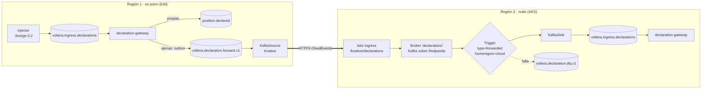

# Plan: Knative Eventing entre los `declaration-gateway` (junto al Event Mesh actual)

Estado: **propuesta**. Nada de lo descrito aquí está implementado ni probado.

## 1. Objetivo

Demostrar el uso de **Knative Eventing** como segundo mecanismo de comunicación entre regiones, **sin
tocar** lo que ya funciona:

| Canal | Qué transporta | Entre | Tecnología | Cambia |
|---|---|---|---|---|
| Event Mesh (actual) | `EnergyMatched`, precios, heartbeat, failover | `mesh-bridge` → `mesh-router` → Facturación / engine | Código propio en Go | **No** |
| Ruteo de declaraciones (nuevo) | Declaraciones de medidores de **otra** región | `declaration-gateway` on-prem → `declaration-gateway` nube | Knative (KafkaSource, Broker, Trigger, KafkaSink) | Se agrega |

El `mesh-router`, el `mesh-bridge`, el failover, la deduplicación por `ce-id` y las pruebas actuales
(`failover-test`, `trace`) siguen tal cual.

El caso de uso de §2 existe para justificar el canal nuevo. La meta real es mostrar Knative en
funcionamiento y compararlo con el mesh hecho a mano.

## 2. Caso de uso: medidores atendidos por un head-end de otra región

**Situación.** El head-end AMI de cada región recibe las lecturas de todos los medidores que tiene al
alcance físico. Algunos de esos medidores pertenecen comercialmente a la **otra** región de mercado.
Por ejemplo, un prosumidor en la frontera, o un medidor reasignado tras un cambio de comercializador.
El ID ya lleva la región dueña: `AMI-<region>-NNNN`.

**Problema hoy.** El `declaration-gateway` on-prem acepta cualquier declaración. Una declaración de
`AMI-cloud-0007` que entra por on-prem:

- se calza en el libro de órdenes **equivocado** (on-prem en lugar de la nube);
- se factura con la ruta `onprem->onprem`, aunque el contrato es de la nube;
- puede calzarse **dos veces** si ese mismo medidor también reporta por su head-end propio.

**Requisito nuevo.** Cada `declaration-gateway` acepta solo declaraciones de medidores de su región.
Las ajenas se **reenvían al `declaration-gateway` de la región dueña**, conservando el `ce-id`, la
traza y la garantía de entrega.

**Por qué Knative y no el mesh actual.**

- Es tráfico de **ingesta**, no de consolidación. Mezclarlo en el `mesh-router` acoplaría dos
  responsabilidades distintas en el mismo componente.
- El ruteo se decide por un **atributo** del evento (`homeregion`). Eso es exactamente lo que hace un
  Trigger con `filter`, de forma declarativa y sin código.
- Agregar una tercera región solo requiere un Trigger nuevo, sin desplegar código.
- Reintentos, backoff y dead-letter vienen de la plataforma (`delivery`), no se programan.
- Permite comparar, con el mismo lab, un event mesh **hecho a mano** contra uno **estándar** (§6, K7).

## 3. Diseño



**Recorrido de una declaración ajena:**

1. El `injector` on-prem genera `AMI-cloud-0007`.
2. El `declaration-gateway` on-prem ve que `homeregion(meter_id) != REGION`. No la persiste como
   posición. Escribe en el outbox un evento `com.voltera.ami.declaration.forwarded.v1` en el topic
   `voltera.declaration.forward.v1`, con las extensiones `homeregion=cloud` y `originregion=onprem`.
   Conserva el mismo `ce-id` y el `traceparent`.
3. El **KafkaSource** on-prem lee ese topic y hace POST del CloudEvent al ingress público de la nube
   (`/knative/declarations`).
4. Istio enruta al **Broker** `declarations` de la nube, respaldado por Kafka sobre el Redpanda
   existente.
5. El **Trigger** filtra por `type` y `homeregion=cloud` y entrega al **KafkaSink**.
6. El KafkaSink escribe en `voltera.ingress.declarations` de la nube, la cola normal de ingesta.
7. El `declaration-gateway` de la nube la procesa como cualquier otra declaración. KEDA lo escala y el
   `ON CONFLICT(id)` absorbe cualquier reentrega.

El gateway de la nube **no cambia**: recibe las declaraciones reenviadas por su cola de siempre.

**Dirección.** El lab solo demuestra on-prem → nube, porque k3d no es alcanzable desde AKS (el mismo
límite que ya tiene el `mesh-bridge`). La dirección nube → on-prem es simétrica en configuración, pero
requiere exponer el ingress on-prem. Queda fuera de alcance.

**Autenticación.** El KafkaSource no envía headers arbitrarios. Para el lab se usa
`ceOverrides.extensions.meshtoken`, que llega como header `Ce-Meshtoken`, y una `AuthorizationPolicy`
de Istio en `/knative/*` que lo exige. Es un compromiso de laboratorio: en producción se usaría mTLS
entre clusters u OIDC.

## 4. Cambios

### Código (mínimo)

| Archivo | Cambio |
|---|---|
| `services/internal/domain/events.go` | `TopicForward`, `TopicDLQ`, `TypeForwarded`; función `HomeRegion(meterID)` que lee `AMI-<region>-NNNN` |
| `services/cmd/declaration-gateway/main.go` | En `ingest`: si la región no coincide, escribe solo en el outbox hacia `TopicForward` con las extensiones; no inserta en `declarations`. Cuenta `forwarded` |
| `services/internal/platform/kafka.go` / `event.go` | Permitir extensiones CloudEvent extra como headers `ce_<ext>` |
| `services/cmd/injector/main.go` | Flag `-foreign <ratio>`: una fracción de los medidores usa el prefijo de la otra región |

### Manifiestos (nuevo overlay, para no tocar `base`, `onprem` ni `cloud`)

```
deploy/knative/
  onprem/  kafkasource-forward.yaml        # topic forward → https://<mesh-dns>/knative/declarations
  cloud/   broker-declarations.yaml        # Kafka Broker (bootstrap = redpanda.voltera)
           trigger-forwarded.yaml          # filtro type + homeregion=cloud, delivery con retry y DLQ
           kafkasink-ingress.yaml          # → voltera.ingress.declarations
           istio-knative-route.yaml        # VirtualService /knative/ + AuthorizationPolicy
```

Los topics `voltera.declaration.forward.v1` y `voltera.declaration.dlq.v1` se agregan al Job
`redpanda-topics` de `deploy/base/redpanda.yaml`.

### Add-ons y scripts

- `infra/addons/install.(ps1|sh)`: nuevo target `knative`, con versiones fijadas en `versions.env`.
  - On-prem: Knative Eventing core + controlador de KafkaSource.
  - Nube: Knative Eventing core + Kafka Broker + KafkaSink (eventing-kafka-broker).
  - Sin Knative Serving: no hace falta.
- `scripts/lab.(ps1|sh)`:
  - `addons -Target all -Knative`, y `deploy` aplica `deploy/knative/<target>` si está instalado.
  - **`cleanup` hoy borra Knative por completo.** Hay que acotarlo para que no elimine la instalación
    nueva: solo restos de Knative Serving / `ksvc` antiguos.
  - Nuevo comando `knative-test` que ejecuta K1 a K6 (§5).
  - `status` muestra `forwarded` del gateway on-prem, lag del KafkaSource y conteo de la DLQ.

## 5. Pruebas

Escenario base: `inject -Target onprem -N 500 -Foreign 0.2`, es decir, unas 100 declaraciones ajenas.

| # | Propiedad | Cómo se prueba | Criterio de éxito |
|---|---|---|---|
| K1 | Ruteo correcto | Contar en ambos gateways | On-prem persiste ~400 y reenvía ~100; la nube persiste exactamente esas ~100 |
| K2 | Filtro del Trigger | Enviar un `forwarded` con `homeregion=onprem` directo al Broker | No llega a `voltera.ingress.declarations` de la nube |
| K3 | Sin pérdida ante caída | `aks -Action stop` (o borrar el Broker) durante la inyección y luego restaurar | El lag del KafkaSource crece y se drena; la nube termina con las ~100 |
| K4 | Idempotencia | Resetear el offset del KafkaSource y reprocesar | La nube no duplica (`declaración duplicada ignorada`) |
| K5 | Dead-letter | Hacer fallar el KafkaSink (topic destino borrado) | Los eventos terminan en `voltera.declaration.dlq.v1`, no se pierden |
| K6 | Autenticación | POST a `/knative/declarations` sin token y con token malo | 403 en ambos; el válido pasa |
| K7 | Comparación con el mesh | Misma carga por el mesh (`EnergyMatched`) y por Knative (declaraciones) | Tabla de latencia p50/p95, RAM adicional por cluster y líneas de código propio |
| K8 | Trazabilidad | Seguir una declaración ajena en App Insights | `inject` (onprem) → gateway onprem → … → gateway nube bajo el mismo `operation_Id` |

**K8 es el riesgo principal.** Hay que verificar que KafkaSource y Broker propaguen `traceparent`. Si
no lo hacen, la traza se corta en el KafkaSource. En ese caso se documenta como hallazgo de la
comparación (K7).

Cómo ver el canal en App Insights, qué spans esperar y las consultas KQL: [`KNATIVE.md`](KNATIVE.md).
Las pruebas existentes (`failover-test`, `trace`, KEDA) se siguen corriendo para confirmar que el
mesh no se vio afectado.

## 6. Comparación a reportar (K7)

| Dimensión | Event Mesh propio | Knative Eventing |
|---|---|---|
| Código propio | `mesh-bridge` + `mesh-router` | Solo el desvío en el gateway; el resto es YAML |
| Ruteo | `switch` en Go | `Trigger.filter` declarativo |
| Reintentos / DLQ | Programados | `delivery` de la plataforma |
| Deduplicación | En el router (`ce-id`) | En el consumidor (`ON CONFLICT`) |
| Autenticación | `X-Mesh-Token` en código | Istio `AuthorizationPolicy` |
| RAM adicional | ~0 | A medir (antes y después) |
| Latencia p50/p95 | A medir | A medir |

## 7. Pasos de ejecución

1. **Medir la RAM base** de ambos clusters (`kubectl top nodes`) antes de instalar nada.
2. **Instalar Knative** con el nuevo target de add-ons y volver a medir. Si AKS (1× `B4ms`) no tiene
   margen, ver §8.
3. **Código:** `HomeRegion`, desvío en el gateway, extensiones CE, flag `-foreign` del injector.
4. **Manifiestos** de `deploy/knative/` y topics nuevos.
5. **Scripts:** acotar `cleanup`, integrar `deploy`/`status` y crear `knative-test`.
6. **Correr K1 a K8**, y luego `failover-test` y `trace` para confirmar que el mesh sigue igual.
7. **Documentar:** sección nueva en `EVENT_MESH.md`, pasos en `LAB_RUNBOOK.md`, costo en `FINOPS_AKS.md`
   y diagrama en el `README.md`.

## 8. Riesgos

| Riesgo | Mitigación |
|---|---|
| Knative devuelve el consumo de RAM (se había retirado para liberar ~1.5 GB, `FINOPS_AKS.md`) | Instalar solo Eventing más los componentes Kafka mínimos; réplica única de cada controlador. Si no cabe, apagar el dataplane del Broker fuera de las demos |
| `cleanup` borra Knative | Acotarlo en el paso 5, antes del primer `deploy` |
| `traceparent` no se propaga por KafkaSource o Broker | Verificar en K8; documentarlo como diferencia frente al mesh propio |
| Incompatibilidad de eventing-kafka-broker con Redpanda | Probar primero el Broker en k3d; Redpanda implementa el API de Kafka, pero hay que confirmarlo |
| La autenticación vía extensión CE es débil | Declararlo como compromiso de laboratorio (§3) |
| Las declaraciones ajenas duplican la carga del medidor | El `ce-id` se conserva de punta a punta, así que el `ON CONFLICT` de la nube absorbe repeticiones |

## 9. Fuera de alcance

- Reemplazar o simplificar el `mesh-router` / `mesh-bridge` o el failover. Esa era la propuesta
  anterior de este documento y queda descartada.
- La dirección nube → on-prem del ruteo de declaraciones.
- Knative Serving.

## 10. Resultado esperado

Dos canales entre regiones conviviendo en el mismo lab, cada uno explicable en una frase:
*el mesh propio consolida los calces y cubre el failover; Knative enruta las declaraciones hacia su
región dueña*. La comparación de §6 da evidencia concreta de qué aporta una plataforma estándar frente
al código propio.
