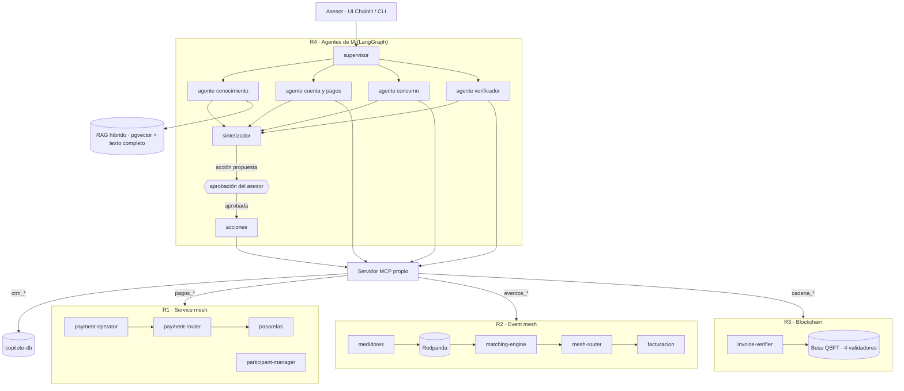

# Arquitectura unificada · Copiloto de facturación Voltera

## Caso de negocio

Un asesor del call center de facturación atiende a un cliente identificado por su NIC. El copiloto le ayuda a:

1. validar los datos del cliente y su contrato;
2. explicar la factura con la tarifa vigente y los calces de energía P2P que la originaron;
3. confirmar si un pago llegó y por qué pasarela;
4. probar que la factura no fue alterada, con evidencia de la cadena;
5. proponer la siguiente acción (abrir un reclamo o registrar un pago), que solo se ejecuta si el asesor la aprueba.

Cada capacidad la resuelve un agente distinto, y cada agente consume una de las arquitecturas de los retos anteriores.

## Vista general

## Agentes

| Nodo | Responsabilidad | Herramientas que ve | Arquitectura |
|---|---|---|---|
| `supervisor` | Extrae NIC y factura, decide qué especialistas corren (en paralelo) | ninguna | — |
| `conocimiento` | Políticas, tarifas, contrato del cliente actual | RAG | RAG híbrido |
| `cuenta_pagos` | Cliente, facturas, pagos por referencia | `crm_*` de lectura, `pagos_*` de lectura | R1 + base de datos |
| `consumo` | Calces de energía del medidor | `eventos_*`, `crm_buscar_cliente` | R2 |
| `verificador` | Integridad de la factura | `cadena_*`, `crm_facturas_de_cliente` | R3 |
| `sintetizador` | Respuesta al asesor, guion para el cliente, acción propuesta | ninguna | — |
| `acciones` | Ejecuta la escritura aprobada | `crm_crear_reclamo`, `pagos_registrar_pago` | R1 + base de datos |

## Servidor MCP

Un servidor (`retos/r4-agentes-ia/mcp_server`, HTTP streamable en `:8000/mcp`) con 12 herramientas agrupadas por prefijo. Es la única puerta de los agentes hacia los otros retos.

| Prefijo | Destino | Cómo |
|---|---|---|
| `crm_` | `copiloto-db` | SQL parametrizado, rol de solo lectura; `crm_crear_reclamo` usa un rol que solo puede insertar reclamos |
| `pagos_` | R1 | HTTP a `payment-operator` y `participant-manager`; `pagos_por_factura` lee `payments.reference` en modo solo lectura |
| `eventos_` | R2 | HTTP a `facturacion` (`/invoices`, `/stats`) |
| `cadena_` | R3 | HTTP a `invoice-verifier` |

## Guardas

- **Aprobación humana**: el grafo se interrumpe antes de cualquier escritura; rechazar no ejecuta nada.
- **Mínimo privilegio**: ningún especialista recibe herramientas de escritura.
- **Argumentos de escritura fuera del modelo**: el monto y el deudor de un pago salen del CRM, no del LLM; el modelo solo aporta tipo, motivo y prioridad.
- **Validación de identificadores** (NIC, factura, medidor) en el servidor MCP, antes de tocar SQL o HTTP.
- **Sin cadena no hay veredicto**: si el verificador no responde, la herramienta devuelve `SIN_VEREDICTO`, nunca `ALTERADA`.
- **Aislamiento por cliente en el RAG**: el contrato de un cliente solo es visible en consultas de ese NIC.
- **Idempotencia**: los pagos llevan `Idempotency-Key`.

## Datos de demo

Los tres retos no compartían identidades. `scripts/seed.sh` crea un conjunto coherente: cada cliente tiene NIC, medidor (`AMI-cloud-NNNN`) y participante de pagos; su factura se ancla en Besu con el mismo identificador que usa el CRM y que sirve de referencia del pago.

| NIC | Escenario | Qué debe encontrar el copiloto |
|---|---|---|
| NIC-2001001 | Factura alta | Línea `compra_p2p` elevada, calces del medidor, factura ÍNTEGRA |
| NIC-2001002 | Pagó y sigue pendiente | Pago `SUCCEEDED` en R1 con la factura aún pendiente → reclamo de prioridad alta |
| NIC-2001003 | Factura alterada | Veredicto ALTERADA (`huella_distinta`) → reclamo de prioridad alta |
| NIC-2001004 | Sin anclar | Veredicto NO ANCLADA |

## Despliegue

Un `docker-compose.yml` raíz con perfiles `pagos`, `eventos`, `cadena`, `ia` y `todo`. Reutiliza los compose de R1 y R3 con overrides de puertos y red, y define R2 en una sola región (R2 solo tenía manifiestos de Kubernetes). Istio, Knative y AKS siguen operables desde la carpeta de cada reto; la demo del copiloto no los requiere, así que en ella el tráfico entre servicios no pasa por el mesh.

## Decisiones relacionadas

- [ADR 0001 · Tipo de RAG](adr/0001-tipo-de-rag.md)
- Orquestación con LangGraph: grafo versionado y testeable, con interrupción nativa para la aprobación humana.
- LLM intercambiable por variables de entorno (`copiloto/llm.py`).
