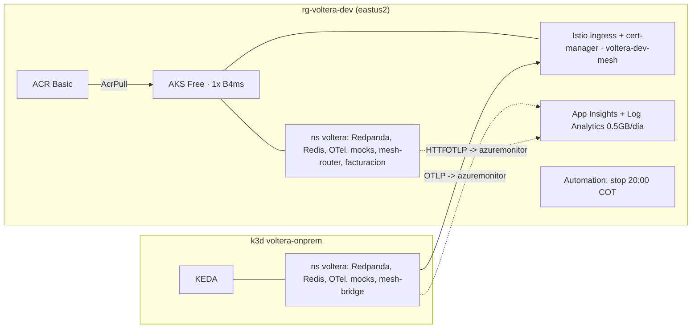

# infra/

Infraestructura de las dos regiones del lab EDA ([`docs/ARCH.md`](../docs/ARCH.md)).

| Carpeta | Contenido |
|---|---|
| [`local-k3s/`](local-k3s) | Cluster k3d `voltera-onprem` (región 1, on-prem simulado) |
| [`azure-terraform/`](azure-terraform) | AKS `voltera-dev-aks` (región 2), ACR Basic, Log Analytics + App Insights, FinOps Automation |
| [`addons/`](addons) | KEDA (ambas regiones), más Istio edge y cert-manager (solo AKS) |
| `manage.ps1` / `manage.sh` | CLI de ciclo de vida: `local start\|stop\|delete\|status\|addons`, `azure status\|start\|stop\|connect\|plan\|apply\|addons` |

Las cargas de trabajo se despliegan desde [`deploy/`](../deploy) con [`scripts/lab.ps1`](../scripts/lab.ps1).
Knative, APIM y Event Grid se retiraron porque no forman parte de ARCH.
